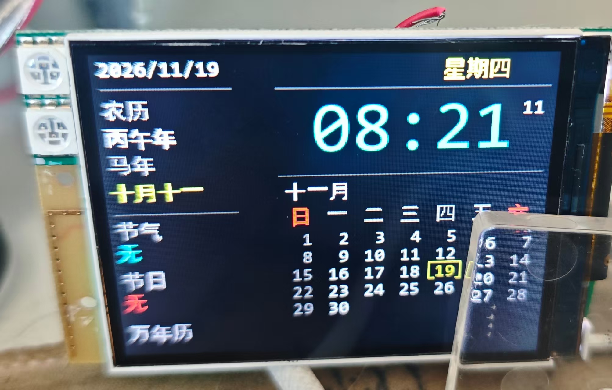

# DLG-CLOCK：盒马彩色电子价签 → 离线万年历

把 **DA14585 + ST7789 240×320 IPS** 的蓝牙电子价签，改造成一块**完全脱离电脑**的桌面万年历。

- 上电即显示：公历年月日 / 星期、农历、干支年、生肖、24 节气、节日、当月月历网格、大字时钟
- **不需要电脑常开、不需要 WiFi、不需要联网**：时间由固件本地 RTC 走时，断电后从 SPI Flash 快照恢复
- 蓝牙**只用于对时**：浏览器 Web Bluetooth 页面 / 手机 nRF Connect / 一次性 Python 脚本，连上写一次 `0x91` 就能断开
- 没有「主机未连接」提示，没有模拟监控数据；连接状态只表现为右上角的蓝牙小图标（绿=已连，灰=未连）



> 屏幕中间的深色间隔是给物理漏液带（x 96..116）留的保护区，见 [硬件说明](docs/01-hardware.md)。

本项目在 [luo-yihuan/DA14585-ble-monitor](https://gitee.com/luo-yihuan/DA14585-ble-monitor) 基础上改造，
对时协议移植自 [tpunix/HMCLOCK](https://github.com/tpunix/HMCLOCK) 的 HMWEBCTRL。

---

## 快速开始

### 1. 烧固件（只需 J-Link，不需要 SDK / 编译器）

仓库已带编译好的固件：

| 外观 | 固件 |
|---|---|
| **侧灯版**（RGB 灯珠在左上角） | `firmware/release/pcmonitor.bin` |
| **中间灯版**（灯珠在面板中部） | `firmware/release/pcmonitor_middle.bin` |

```bat
:: 侧灯版（默认）
python tools\flash.py --jlink "C:\Program Files\SEGGER\JLink_V818"

:: 中间灯版
python tools\flash.py --bin firmware\release\pcmonitor_middle.bin --jlink "C:\Program Files\SEGGER\JLink_V818"
```

`flash.py` 把镜像载入 RAM 并置 `selflash` 标记，固件启动后自动把自身写入 SPI Flash A/B 分区，
**断电重启仍会运行本固件**。详见 [03 烧录固件](docs/03-flash.md)。

### 2. 对一次时（三选一，都是一次性的，不常驻）

| 方式 | 怎么做 |
|---|---|
| **浏览器（推荐）** | 打开本仓库 GitHub Pages 的 `web/` 页面（HTTPS），点「连接设备」→「同步时间」；或本地 `python -m http.server 8000 -d web` 后访问 `http://localhost:8000` |
| **手机** | nRF Connect 连上 `DLG-CLOCK-*`，对 `0000ff01-0000-1000-8000-00805f9b34fb` 写 12 字节 `0x91` 包；格式见 [docs/11-web-timesync.md](docs/11-web-timesync.md) |
| **电脑脚本** | `python tools/sync_time.py`（可加 MAC 加速，如 `18:BC:5A:5A:22:CA`）；`--nrf-help` 打印手机手动写法，`--reset-bt` 用于 Windows 蓝牙适配器卡住时复位 |

浏览器页面还支持 **「时间校准」**：对时满 2 天后，比较设备分钟跳变与系统分钟跳变算出晶振漂移，
写 `0x92` 让固件长期修正 1 秒节拍。完整说明见 [docs/11-web-timesync.md](docs/11-web-timesync.md)。

### 3. 之后就不用管了

拔掉 J-Link、关掉电脑，价签照样走时。时间快照每分钟写一次 SPI Flash（`0x3C000` 扇区，256 槽顺序追加），
重启最多慢 1 分钟。

> **固有限制**：DA14585 没有掉电保持的 RTC。**长时间断电后，时间会落后断电时长**——
> 因为固件只能恢复到最后一次快照，无法知道断电期间过了多久。重新对时一次即可。
> 晶振长期漂移也靠偶尔跑一次同步 / 校准来修正。

---

## 固件里的独立万年历

| 机制 | 说明 |
|---|---|
| `STANDALONE_CALENDAR=1` | 编译期锁定万年历卡片（`CARD_CALENDAR=5`），禁用 `0xC8` 切卡、不显示「主机未连接」、不生成模拟监控数据 |
| 本地 RTC | 1 秒 `app_easy_timer` tick，`clock_update()` 走时；时间**永远来自本地**，与蓝牙/电脑是否连接无关 |
| 离线历法引擎 | 固件内建 2020–2051 农历表、24 节气、节日表；`0x91` 只传公历，农历/星期/节气/节日全部自行重算 |
| 中文点阵字库 | `src/ui/cal_font.h`，simhei 16px 1bpp，覆盖节气 / 节日 / 干支 / 生肖 / 农历数字 |
| Flash 时间快照 | `0x3C000` 扇区，256 个 16 字节槽，每分钟顺序追加、写满才擦除；`0x91` 对时后立即写一次 |
| 兜底 | 首次烧录无快照时用编译时间（`__DATE__` / `__TIME__`） |
| 广播 | 断开后无条件重启广播，保证手机 / 网页随时能再连上 |

`CFG_VERSION=4`；配置放在 `0x3B000` 扇区（`PCM1` 头）。

## BLE 协议速查

主服务 `0xFF00`（`0000ff00-0000-1000-8000-00805f9b34fb`），长值特征 `0xFF01`（Read / Write Request），
电压 `0xFF02`，控制点 `0xFF03`。

| 首字节 | 含义 | 载荷 |
|---|---|---|
| `0x91` | 同步时间 | `[1..2]` 年 uint16 小端、`[3]` 月(0-based)、`[4]` 日、`[5..7]` 时分秒；后 4 字节为 HMCLOCK 农历字段，本固件忽略 |
| `0x92` | 时钟漂移校准 | `[1..2]` 有符号秒差 int16 小端 + `[3]=0`；要求 `cal_minute ≥ 2880` |
| `0xFF01` 回读 | 设备当前时间 | 13 字节：年(2) 月 日 时 分 秒 + `cal_minute` int32 + 修正值 int16，**连接期间每秒刷新** |

`0xB0~0xB3`（PC 监控数据）、`0xC0~0xC8`（配置/切卡）、`0xA0+`（OTA）仍保留在固件里，
但独立万年历模式不需要它们。详见 [05 蓝牙协议](docs/05-protocol.md) 与 [11 浏览器对时](docs/11-web-timesync.md)。

---

## 仓库结构

```
├─ web/
│  └─ index.html                 浏览器 Web Bluetooth 对时 / 校准页（自包含、无 CDN 依赖）
├─ firmware/
│  ├─ pcmonitor/                 固件源码（放到 SDK 里用 build.py 编译）
│  │  ├─ src/ui/                 万年历 / 监控界面 + 中文字库
│  │  ├─ src/epd/                ST7789 软件 SPI 驱动 + SPI Flash / RTC 快照
│  │  ├─ src/custom_profile/     GATT 0xFF00 服务定义
│  │  ├─ src/config/             SDK 配置（ARCH_SLEEP_OFF 等）
│  │  ├─ startup/                crt0
│  │  ├─ build.py                一键编译
│  │  └─ sources.txt / includes.txt
│  └─ release/                   已编译固件（侧灯版 / 中间灯版，bin + hex + json）
├─ tools/
│  ├─ flash.py                   一键烧录（只需 J-Link）
│  ├─ sync_time.py               一次性蓝牙对时脚本
│  ├─ ota.py / cards.py / pc_monitor_gui.py / weather.py / preview_ui.py / gen_font.py
│  ├─ install_pc_agent.ps1       （历史遗留）原 PC 常驻推送
│  └─ uninstall_pc_agent.ps1     （历史遗留）注销 PC 常驻推送
└─ docs/                         全部文档（01~10 为上游 PC 副屏文档，11 为本项目的浏览器对时文档）
```

> `docs/01~10` 与 `AGENTS.md` 描述的是**上游的 PC 状态副屏**用法（需要电脑端每秒推送）。
> 本仓库的固件已改为独立万年历，**默认不需要 `pc_agent.py`**；这些文档仅作为编译、烧录、硬件、协议参考。

## 自己编译

需要 Renesas SmartBond **SDK 6.0.22.1401** 与 **Arm GNU Toolchain 12.2**，把 `firmware/pcmonitor/`
放到 `<SDK>/projects/target_apps/ble_examples/pcmonitor/` 下：

```bat
set PANEL_MIDDLE=0 && python build.py --gcc <arm-none-eabi\bin>   :: 侧灯版
set PANEL_MIDDLE=1 && python build.py --gcc <arm-none-eabi\bin>   :: 中间灯版
```

`build.py` 按源码内容自动生成 `EPD_VERSION`，`selflash()` 靠它判断是否需要把新镜像写进 Flash。
详见 [02 编译环境与构建](docs/02-build.md)。

## 文档索引

- [11 浏览器 Web Bluetooth 对时与校准](docs/11-web-timesync.md) ← **日常使用入口**
- [01 硬件、接线与屏幕校准](docs/01-hardware.md)
- [02 编译环境与构建](docs/02-build.md)
- [03 烧录固件](docs/03-flash.md)
- [05 蓝牙协议](docs/05-protocol.md)
- [07 常见问题](docs/07-faq.md)
- [09 蓝牙 OTA 升级](docs/09-ota.md)
- [AGENTS.md](AGENTS.md) — 上游项目的 AI Agent 自动复刻说明

## 风险与免责

- 拆机、飞线、烧录 **可能导致设备变砖**，请自行承担风险，并先备份。
- 固件启动时会执行 `selflash()`，把当前 RAM 镜像写入价签 SPI Flash A/B 分区。
  这会让价签断电后仍运行本固件；想恢复原厂界面需要原厂镜像，本仓库不提供。
- 本项目仅用于个人学习与自用，不涉及任何商业用途。价签硬件、Dialog/Renesas SDK 的版权归各自所有者。

## 许可

代码以 MIT 协议开源，见 [LICENSE](LICENSE)。SDK 代码不随本仓库分发。
