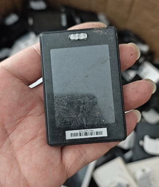

# 01 硬件、接线与屏幕校准

## 1. 这是块什么设备

盒马彩色电子价签，特点：

- 主控 **Dialog/Renesas DA14585**（Cortex-M0，96KB RAM，**没有片内 Flash**）
- 屏幕 **ST7789 驱动，240×320 IPS**（横屏使用 320×240）
- 两颗 WS2812 灯珠（本项目未使用）
- 外部 SPI Flash 存固件，OTP bootloader 从 Flash 加载




## 2. 两个硬件版本（重要）

同款价签有两种**灯珠位置**不同的面板，**两种都已适配**，区别只在屏幕初始化参数：

| 版本 | 特征 | 屏参 | 固件 |
|---|---|---|---|
| **侧灯版** | RGB 灯珠在面板**左上角**边缘 | `MADCTL=0x60` + `INVON` | `release/pcmonitor.bin` |
| **中间灯版** | RGB 灯珠在面板**中部** | `MADCTL=0x28`（左右镜像 + BGR）+ `INVOFF` | `release/pcmonitor_middle.bin` |

- **LED 引脚两版完全相同**：红 P0.2 / 绿 P2.5 / 蓝 P2.9，低电平点亮
- 编译中间灯版：`set PANEL_MIDDLE=1` 后再跑 `build.py`（见 [02-build.md](02-build.md)）
- 烧错版本不会损坏：只会画面左右反、或红/蓝偏色，换对应 bin 重烧即可

改方向（自定义）：编辑 `firmware/pcmonitor/src/lcd/st7789.c` 里 `0x36` 的写入值：

```c
#if PANEL_MIDDLE
    lcd_data8(0x28);   /* 中间灯版: MV | BGR */
#else
    lcd_data8(0x60);   /* 侧灯版: MX | MV */
#endif
```

也可以调用 `ui_dir_test(0..3)`（自带的方向自检画面，4 种组合分别是 `0x28/0x68/0xA8/0xE8`），
看哪个方向四角红绿蓝白标记和数字都是正的。

## 3. 屏幕引脚（软件 SPI）

从原厂固件的板级初始化表反汇编得到，全部用 GPIO 模拟：

| 信号 | 引脚 | 说明 |
|---|---|---|
| LCD_SCK | **P0_1** | 时钟（U5 第13脚 SCLK） |
| LCD_SDA | **P2_0** | 数据（U5 第14脚 SDI） |
| LCD_CS | **P2_1** | 片选，低有效（U5 第12脚 nCS） |
| LCD_DC | **P0_7** | 1=数据，0=命令（U5 第11脚 D/C） |
| LCD_RST | **P1_0** | nRST（U5 第10脚），低电平复位，必须显式驱动 |
| 电源使能 | **P2_3** | PWR_EN，初始化时拉低再拉高 |

> **LCD_RST 是必须的**：早期固件没驱动 P1_0，靠面板上电自复位，结果出现
> "有背光但黑屏"。现在 `st7789_init()` 里会先把 P1_0 拉低 30ms 再拉高，
> 并等待 120ms 后才发初始化命令。

初始化时序：`0x11`(Sleep Out) → 120ms → `0x36`(MADCTL) → `0x3A=0x55`(RGB565) → `0x21`(INVON) → `0x29`(Display On)。

> 原厂固件反汇编整理出的完整引脚表见 [pinout.xlsx](pinout.xlsx)（含电池、按键、SPI Flash 等）。

> **颜色反相问题**：ST7789 模块有 IPS/非 IPS 两种，颜色反了就删掉 `0x21` 换成 `0x20`，反之亦然。
> 本项目当前发 `0x21`，实测颜色正常。

## 4. 屏幕坏点（漏液带）校准

很多二手价签屏上有一道竖向的液晶漏液条纹，本固件把它当作分栏间隙，**在坏点区域什么都不画**。

默认保护区：**x 98..112**（实测坏点在 x100..110，两侧各留 2px）。

如果你的坏点位置不同，用自带的刻度尺模式量一下：

1. 打开 `firmware/pcmonitor/src/ui/monitor_ui.c`
2. 把 `#define UI_CALIB 0` 改成 `1`
3. 重新编译烧录，屏幕会显示带数字的刻度尺（每 10px 一根白刻度，每 50px 一根黄刻度并标数字，青色竖线是当前保护区）
4. 读出坏点覆盖的刻度范围
5. 改这两处常量后把 `UI_CALIB` 改回 `0`：

```c
#define LEFT_X1       96     /* 左栏右边界 = 坏点左边缘 - 2 */
#define RIGHT_X0      114    /* 右栏左边界 = 坏点右边缘 + 2 */
```

刻度尺模式同时也是一个很好的「屏幕是否正常工作」自检画面。

## 5. J-Link 接线

价签背面有测试点（丝印可能不同，用万用表确认）：

| J-Link | 价签 |
|---|---|
| SWDIO / TMS | SWDIO 测试点 |
| SWCLK / TCK | SWCLK 测试点 |
| GND | GND |
| VTref / 3.3V | VCC（3.3V） |

注意：

- **不要用 5V**，DA14585 是 3.3V 器件。
- 价签装机后电池仓附近可能有开关，烧录时保持供电稳定。
- 若 J-Link 报 `Target voltage: 0V`，检查 VCC/GND 是否接好，或价签是否需要按一下按键唤醒。

## 6. 灯珠（RGB 状态灯）

板载两颗 6 脚 5×5mm 的 **共阳 RGB LED**，两颗完全并联（颜色永远同步）。
每路阴极经一颗三极管（Q1/Q2/Q4）拉低点亮，因此三路都是**低电平点亮**：

| 颜色 | GPIO | MCU 脚位 | 三极管 |
|---|---|---|---|
| 红 | **P0.2** | 3 | Q2 |
| 绿 | **P2.5** | 32 | Q1 |
| 蓝 | **P2.9** | 39 | Q4 |

> 上表来自原厂固件反汇编的 [pinout.xlsx](pinout.xlsx)，并用万用表实测确认：
> 把三极管 2/3 脚短接，对应颜色就亮（Q1→绿，Q2→红，Q4→蓝）。

当前固件的颜色映射（`src/ui/monitor_ui.c`）：

```c
#define LED_R_PORT  0
#define LED_R_PIN   GPIO_PIN_2   /* 红 */
#define LED_G_PORT  2
#define LED_G_PIN   GPIO_PIN_5   /* 绿 */
#define LED_B_PORT  2
#define LED_B_PIN   GPIO_PIN_9   /* 蓝 */
```

行为：**平时全灭，只有事件才闪一次**（常亮太刺眼）：

| 事件 | 颜色 | 次数 | 触发条件 |
|---|---|---|---|
| CPU 过热 | 红 | 3 次 | CPU 温度连续 5 秒 ≥95℃（之后 10 分钟冷却） |
| 整点报时 | 蓝 | 1 次 | 每小时 `59 → 00` 秒那一刻 |

闪烁节奏由 1Hz 的 `ui_tick()` 推进：亮 1 秒 / 灭 1 秒，结束后保持全灭；
同一时刻只闪一个事件，正在闪时新事件会排队（只保留最近一个）。
如果实际绿蓝相反，交换 `LED_G_*` 与 `LED_B_*` 即可。

> 注意：这不是 WS2812（不可寻址），三路只能整颗同色（红/绿/蓝/黄/青/紫/白）。
> `src/lcd/ws2812.c` 里的 `ws2812_pin()` 只被当作普通 GPIO 写口使用。

## 7. 已知限制

- 固件运行在 **RAM**（约 56KB），启动时的 `selflash()` 会把它写进 SPI Flash 的备用分区，
  所以断电后仍会运行本固件。想回原厂界面需要原厂镜像，本仓库不提供。
- 灯珠只有 3 个通道且两颗并联，只能显示单色（无法做渐变/彩虹）。
- 屏是软件 SPI（约 1MHz 等效），整屏刷新约 100ms；本固件用逐字符差异刷新规避闪烁。
